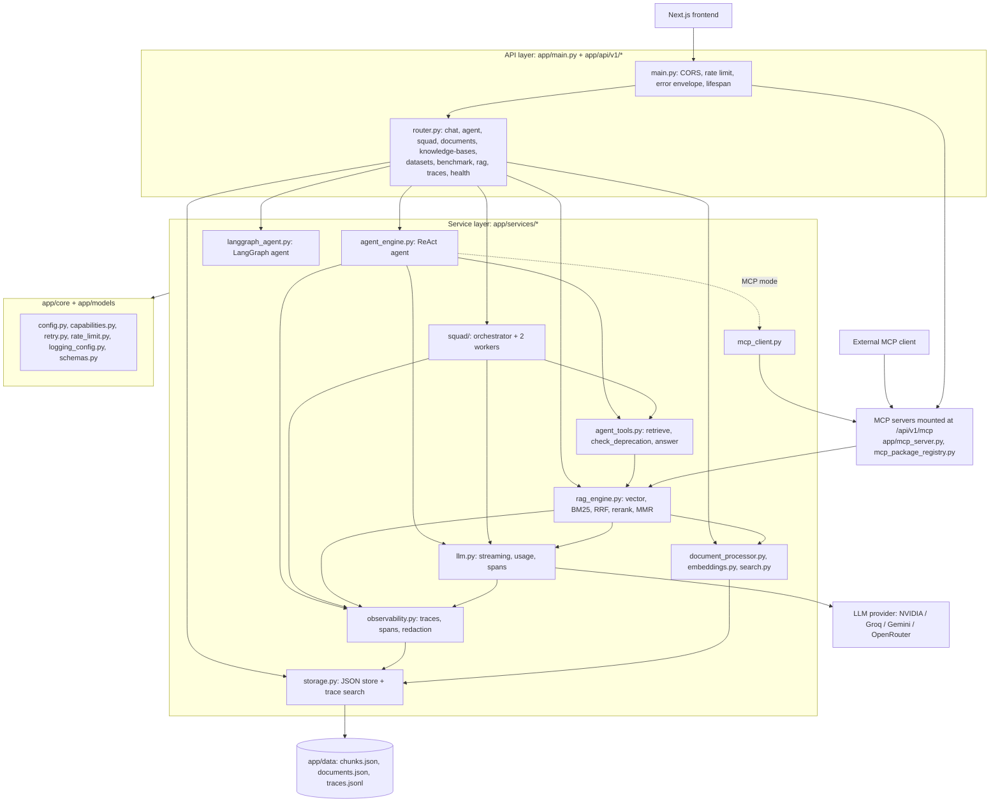

# Ragger Backend: Architecture

A FastAPI RAG backend that keeps the API contract of the Next.js frontend. This document describes the code **as it is
today**; nothing here required moving files. Facts were checked against the code on 2026-10-23.

## 1. Layers (dependencies point downward only)

Rule of thumb: `api` calls `services`; `services` call `core`/`models`; `core` and `models` import nothing from `services`.
`evals/`, `scripts/` and `tests/` sit outside `app/` and import from it, never the reverse.

## 2. The three request flows

| Flow | Entry | Path | Trace |
|---|---|---|---|
| Chat / RAG | `POST /api/v1/chat/*` | `execute_rag` -> retrieve -> `llm.generate_completion_stream` | spans per retrieval stage + `llm.generate` |
| Single agent | `POST /api/v1/agent/run` (`/agent/run-langgraph` for LangGraph) | `AgentEngine`: reason -> tool (`retrieve`, `check_deprecation`, `answer`) -> repeat, up to `max_steps`; optional MCP tools | `agent.run`, `llm.generate`, `tool.*` |
| Squad | `POST /api/v1/squad/run` | `SquadOrchestrator`: route (LLM) -> `version_deprecation` and `code_sample` workers (retry up to 2) -> answer (LLM) | `squad.run`, `llm.generate`, `handoff.*` |

Retrieval strategy comes from `DEFAULT_STRATEGY` or the request. If vector search or the reranker is unavailable, retrieval
degrades to BM25/fused ranking and reports it (`GET /api/v1/health/capabilities`).

## 3. Cross-cutting pieces

- **Tracing:** `observability.py` holds one active `TraceContext` per request (contextvar). `llm.py` records a span for every
  model call with provider-reported tokens; agent/squad record tool and handoff spans; traces are stored in `traces.jsonl`
  and searched by `storage.search_traces` (id, prompt version, chunk id, text in question/answer, latency, cost).
- **Redaction:** `observability.redact` masks credential-style keys and bearer/API-key strings before anything is stored.
- **Token accounting:** `llm.track_usage()` sums every model call once; both benchmark arms use it.
- **Config:** one `settings` object (`core/config.py`, `.env`); `PROMPT_VERSION` is stamped on every trace.

## 4. Evaluation and tooling (outside `app/`)

| Path | Purpose |
|---|---|
| `evals/developer_docs_cases.json` | Week 6 cases (+ `gh-deprecated-001` regression); `known_scoring_issues.json` |
| `app/services/evaluation/scoring.py` | strict keyword scorer used by the Week 10 benchmark |
| `app/services/squad/benchmark.py`, `scripts/run_week10_experiment.py` | single agent vs squad, fault injection, `artifacts/week10/` |
| `scripts/seed_github_kb.py` | load the documents the cases expect into the knowledge base |
| `scripts/trace_search.py`, `trace_export.py`, `cost_by_stage.py`, `week11_live_regression.py` | incident search, trace export, stage cost, live prompt A/B (`artifacts/week11/`) |
| `tests/` | API, scoring, squad orchestration (retries, disclosure, tokens), agent tracing |

## 5. Where Week 12 plugs in (no restructuring needed)

| Capability | Existing seam to extend |
|---|---|
| SDK version resolution | new small module `app/services/sdk_version.py`, called at the top of `agent_engine` / API handler |
| Version-scoped retrieval | `RagEngine.get_context` already filters by `knowledge_base_id`; add a `sdk_version` metadata filter at the same point so agent, tools and MCP all inherit it |
| Symbol check + changelog tools | add to `agent_tools.py` + `TOOL_SCHEMAS` (the registry the agent prompt is built from) |
| MCP expose/consume | add the tool to `app/mcp_server.py`; call it through `mcp_client.py`; pass the trace id as an argument and record a span |
| Single entry point | one CLI file (e.g. `app/cli.py`) wrapping the scripts above |

## 6. Known structural weak spots (deliberately left as they are)

Moving these would touch imports, tests, MCP and the frontend contract for no behavioural gain, so they are listed, not changed:

- Large files: `rag_engine.py` (1,750 lines), `benchmark.py` API (1,042), `storage.py` (791), `langgraph_agent.py` (783).
  Safe split later: `rag_engine` into `retrieval/` (search stages) and `prompting/` (`build_prompt`).
- The squad benchmark lives in `app/services/squad/` although it is evaluation code (`evals/` would be tidier).
- Storage is JSON files and rewrites the whole file per trace; `DATABASE_URL`/`REDIS_URL` in config are not used by it.
- Repo root: notes and task specs now live in `docs/` (`docs/tasks/`, `docs/notes/`). `race*.csv` and `budget_termination_log.txt` stay at the root because code or docs read them by that path; both `venv/` and `.venv/` exist (both are git-ignored).
- The retrieval cache (`retrieval_cache.py`) is in-process only and keyed by (query, strategy, knowledge base).
